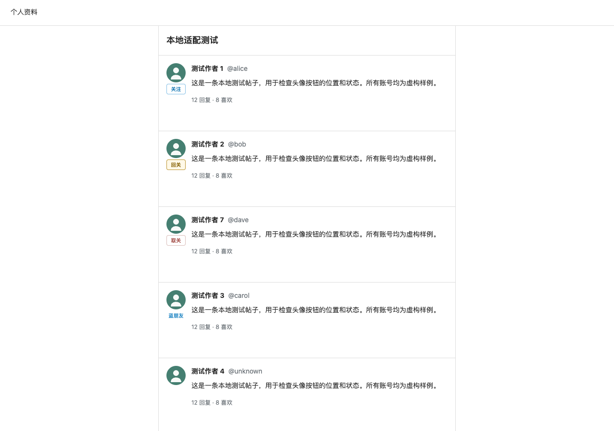
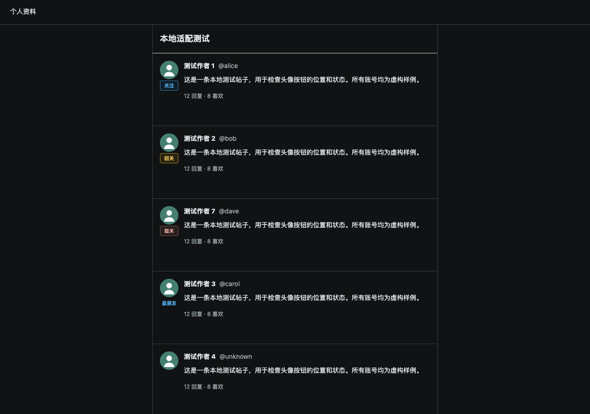
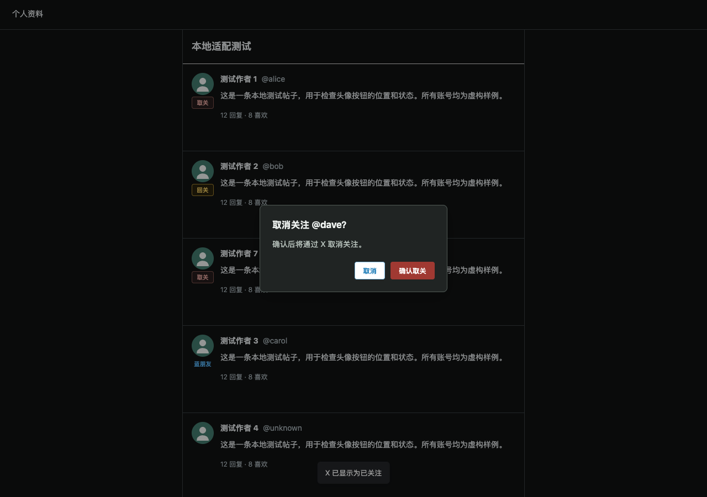
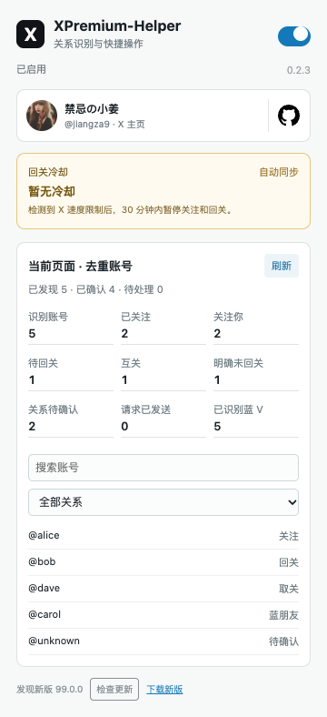
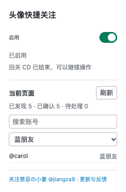

# XPremium Helper

[简体中文](README.md) · [English](README.en.md) · [Español](README.es.md) · [日本語](README.ja.md) · [Português (Brasil)](README.pt-BR.md)

[](https://github.com/Jiangshuo1109/XPremium-Helper/actions/workflows/ci.yml) [](LICENSE)

Extensión para Chrome y Edge que añade acciones de seguir, seguir de vuelta y dejar de seguir debajo de los avatares de X, tras comprobar la identidad y la relación entre las cuentas. Las relaciones mutuas se muestran con una etiqueta sin acción. Cada cambio requiere un clic tuyo y utiliza los controles nativos de X.

**Versión 0.2.1, preliminar.** No está afiliada a X Corp. ni proporciona o desbloquea X Premium. La detección de relaciones en chats de grupo todavía no está validada en el sitio real. La documentación está disponible en cinco idiomas; la interfaz de la extensión está en chino y reconoce principalmente controles de X en chino e inglés.

[Descargar versión preliminar](https://github.com/Jiangshuo1109/XPremium-Helper/releases) · [Informar de un problema](https://github.com/Jiangshuo1109/XPremium-Helper/issues) · [Historial](CHANGELOG.md)

Mantenida por **禁忌の小姜**. [Sigue a @jiangza9 en X](https://x.com/jiangza9) para conocer novedades y avances. Seguir al autor es opcional y no condiciona ninguna función.

> ⚠️ **Aviso:** Esta es una extensión independiente en versión preliminar y no está afiliada a X Corp. Comprueba cada acción y respeta las reglas aplicables de la plataforma. El proyecto no garantiza la exactitud de las relaciones, los resultados en X ni la compatibilidad futura. Consulta el [aviso completo](DISCLAIMER.md).

## Funciones Y Capturas

Las capturas muestran la extensión real en un navegador aislado con cuentas y publicaciones ficticias. No acreditan operaciones completadas en los servidores de X.



| Función | Comportamiento |
| --- | --- |
| Acciones junto al avatar | Seguir y seguir de vuelta requieren una insignia azul reconocida y una relación conocida |
| Seguimiento mutuo | La etiqueta «蓝朋友» solo aparece con evidencia explícita y no se puede pulsar |
| Dejar de seguir | Si sigues a alguien sin relación mutua confirmada, se ofrece una acción con confirmación del usuario objetivo |
| Panel de relaciones | Búsqueda por cuenta, filtros y progreso; muestra el último estado recibido, compartido entre pestañas |
| Enter para publicar o responder | Envía desde un único editor; Shift+Enter añade un salto de línea; respeta la composición IME y la selección de menciones |
| Lectura y espera | Hasta 20 comprobaciones en cola, caché de un minuto en memoria y gestión de espera de 30 minutos ante límites de velocidad |
| Presentación | Temas claro y oscuro y ventanas estrechas de escritorio; no implica compatibilidad con extensiones en móviles |

<details>
<summary>Más capturas: tema oscuro, confirmación, panel y ventana estrecha</summary>







</details>

## Instalación Y Actualización

1. Abre [Releases](https://github.com/Jiangshuo1109/XPremium-Helper/releases) y elige la **Pre-release** más reciente. Descarga `xpremium-helper-chrome-<versión>-preview.zip` o el paquete `edge`. No uses el archivo automático «Source code» para instalar directamente.
2. Descomprime el archivo en una carpeta permanente. Abre `chrome://extensions` o `edge://extensions`.
3. Activa el **Modo de desarrollador**, pulsa **Cargar descomprimida** y selecciona la carpeta que contiene `manifest.json`.
4. Revisa los borradores pendientes antes de recargar las pestañas de X. Puedes activar o desactivar la extensión desde su panel.
5. Para actualizar, sustituye los archivos de la misma carpeta, pulsa **Recargar** en el gestor de extensiones y recarga X.

No hay distribución en tiendas ni actualizaciones automáticas. Compara el archivo con `SHA256SUMS` mediante `shasum -a 256 <archivo.zip>` en macOS o `Get-FileHash <archivo.zip> -Algorithm SHA256` en PowerShell.

Empieza con una cuenta de prueba. **Con la extensión activada, Enter envía publicaciones y respuestas desde un único editor.** Usa Shift+Enter para un salto de línea. Los mensajes privados, hilos con varios editores y publicaciones programadas conservan su comportamiento original.

## Limitaciones

Las acciones permanecen ocultas si faltan pruebas de identidad, relación o controles nativos utilizables. Seguir y seguir de vuelta requieren insignia azul; dejar de seguir y la etiqueta mutua no. La propia cuenta, identidades contradictorias y solicitudes pendientes no se consideran cuentas disponibles para seguir.

Hay adaptadores para inicio, detalle de publicaciones, respuestas y listas de seguidores y seguidos. Los chats de grupo requieren campos explícitos de relación aún pendientes de verificación real; las listas y cabeceras de mensajes privados siguen incompletas. La ausencia de «Te sigue» no demuestra que esa persona no te siga: compruébalo antes de confirmar.

El panel puede mostrar datos de otra pestaña de X por compartir el último estado recibido. Un cambio visible no confirma el resultado definitivo del servidor. No se reintentan automáticamente acciones fallidas; no hay desplazamiento automático, seguimiento masivo, «Me gusta» automáticos ni envío de mensajes privados.

Consulta el [registro de validación, en chino](docs/验证记录.md) para distinguir pruebas locales y comprobaciones pendientes en X.

## Permisos Y Privacidad

Solo solicita `storage` e inyecta scripts en `https://x.com/*`. No necesita claves API, no incluye telemetría ni permiso de cookies y no usa un servidor propio. X recibe las acciones realizadas mediante sus controles nativos.

La configuración y el final del periodo de espera se guardan localmente. Los resúmenes y tareas usan almacenamiento de sesión cuando está disponible; **si falla, recurren al almacenamiento local y pueden persistir tras reiniciar el navegador**. Consulta [Privacidad](PRIVACY.md).

## Desarrollo

Requiere Node.js 22+, npm y `zip` para empaquetar. En Windows utiliza WSL o instala un paquete publicado.

```sh
git clone https://github.com/Jiangshuo1109/XPremium-Helper.git
cd XPremium-Helper
npm ci
npm run check
npx playwright install chromium
npm run test:browser
npm run check:release
npm run package
```

Carga `dist/chrome` o `dist/edge`. Los paquetes se guardan en `release/` y los informes en `artifacts/`, ambos excluidos de Git. Las capturas públicas están en `docs/screenshots/`.

Las pruebas interceptan las solicitudes de red y utilizan páginas ficticias. Chromium es obligatorio; Chrome y Edge ausentes o fallidos se registran como no aprobados. Estas pruebas no sustituyen la validación en el sitio real.

[Contribuir](CONTRIBUTING.md) · [Seguridad](SECURITY.md) · [Aviso](DISCLAIMER.md) · [Publicación de versiones](docs/RELEASING.md) · [Próximos pasos](docs/ROADMAP.md)

Elimina conversaciones reales, listas de cuentas, credenciales y rutas personales antes de compartir informes. Para recibir avisos, usa **Watch → Custom → Releases** o sigue a [禁忌の小姜 @jiangza9](https://x.com/jiangza9).

## Licencia

[MIT](LICENSE). Permite usar, modificar y redistribuir, también comercialmente, conservando el aviso de copyright y la licencia. Las dependencias mantienen sus propias licencias y las marcas de X pertenecen a sus titulares.
