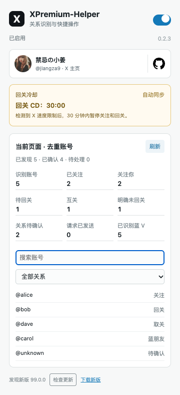

# XPremium Helper · X 头像快捷关注

[简体中文](README.md) · [English](README.en.md) · [Español](README.es.md) · [日本語](README.ja.md) · [Português (Brasil)](README.pt-BR.md)

[](https://github.com/Jiangshuo1109/XPremium-Helper/actions/workflows/ci.yml)
[](LICENSE)
[](https://github.com/Jiangshuo1109/XPremium-Helper/releases)

Chrome / Edge 扩展。在 X 页面核实账号关系后，把「关注」「回关」或需要确认的「取关」入口放到头像下方；互关账号显示「蓝朋友」。每次关系操作都由你点击，并交给 X 原生控件执行。

**当前版本：0.3.1 预览版。** 修复通知页回复弹窗无法显示快捷回复的问题；保留回复框旁快捷回复、模板管理和可选的 OpenAI Chat Completions 兼容接口。生成结果只插入草稿，不自动发送。群聊关系读取尚未完成实站验收。

[下载预览包](https://github.com/Jiangshuo1109/XPremium-Helper/releases) · [反馈问题](https://github.com/Jiangshuo1109/XPremium-Helper/issues) · [版本记录](CHANGELOG.md)

由 **禁忌の小姜** 维护：[关注 @jiangza9](https://x.com/jiangza9)，查看更新、使用记录和开发进展。关注完全自愿，不影响任何功能。

> ⚠️ **免责声明：** 本项目是独立的预览版开源扩展，与 X Corp. 无隶属关系。使用者应自行遵守 X 规则并核对每次操作；项目不保证账号关系判断、平台操作结果或持续兼容性。详见 [完整免责声明](DISCLAIMER.md)。

## 功能与截图

以下截图使用隔离浏览器中的测试构建。帖子与关系数据均为虚构样例，不代表真实 X 服务端操作验收。

**当前页面面板：九项去重统计、关系筛选、作者入口和更新提示**


**头像下的快捷操作**


| 功能 | 当前行为 |
| --- | --- |
| 头像快捷操作 | 可识别蓝 V 且关系明确时显示关注／回关；已关注但未确认互关时显示取关 |
| 互关标签 | 明确互关时显示不可点击的「蓝朋友」，不把未知状态当成互关 |
| 取关确认 | 先展示目标账号确认框，再重新核对 X 原生控件 |
| 关系面板 | 显示打开弹窗时所在 X 标签页的识别进度与去重统计，按账号搜索、按关系筛选 |
| 页面统计 | 识别账号、已关注、关注你、待回关、互关、明确未回关、关系待确认、请求已发送、已识别蓝 V；按账号去重并排除本人 |
| 更新提示 | 打开弹窗检查版本，支持手动检查；GitHub API 失败时读取本仓库公开版本订阅，只提示下载，不自动安装 |
| 作者与项目入口 | 作者头像进入「禁忌の小姜 @jiangza9」主页，GitHub 图标进入源码仓库 |
| Enter 发帖／回复 | 单编辑器按 Enter 发送，Shift+Enter 换行；避让输入法组合输入与提及候选 |
| 读取与冷却 | 最多 20 人预检查队列、一分钟内存关系缓存；用户输入优先，包含 30 分钟速度限制冷却处理 |
| 深浅色与窄窗口 | 按页面背景调整按钮；窄窗口检查不等于支持手机浏览器安装扩展 |

<details>
<summary>展开更多截图：深色、确认框、关系面板和窄窗口</summary>

**深色页面**


**取关前核对目标账号**


**关系筛选与冷却状态**




**390px 窄窗口**


</details>

统计仅覆盖当前页面已识别的账号，不是全账号粉丝总量，也不是操作次数。各指标可能重叠，不能直接相加。「明确未回关」要求已关注且页面明确显示对方未关注你；缺少反向关系证据只计入待确认。搜索与筛选作用于下方列表，不改变上方统计口径。

## 安装与更新

1. 在 [Releases](https://github.com/Jiangshuo1109/XPremium-Helper/releases) 中选择最新 **Pre-release**。Chrome 下载 `xpremium-helper-chrome-<版本>-preview.zip`，Edge 下载对应 `edge` 包。不要下载 GitHub 自动生成的 “Source code” ZIP 来直接安装。
2. 解压到固定目录。Chrome 打开 `chrome://extensions`，Edge 打开 `edge://extensions`。
3. 开启「开发者模式」，点击「加载已解压的扩展程序」，选择包含 `manifest.json` 的目录。
4. 先处理未发送草稿，再刷新已有 X 标签页。扩展弹窗可启用或停用。
5. 更新时把新包解压覆盖到原安装目录，在扩展管理页点击「重新加载」，再刷新 X。

打开弹窗会自动检查公开版本，成功结果缓存六小时，失败结果缓存一分钟；「检查更新」可跳过缓存。发现新版时显示下载入口，检查失败会显示错误原因。自动检查不等于自动安装：当前不通过扩展商店分发，下载后仍需按上面的步骤手动更新。发布页提供 `SHA256SUMS`：macOS 可用 `shasum -a 256 <文件.zip>`，Windows 可用 `Get-FileHash <文件.zip> -Algorithm SHA256` 与其对照。

首次使用建议先在测试账号上检查状态。**启用后 Enter 会触发单编辑器发帖或回复**；要换行请用 Shift+Enter，私信、多编辑器串帖和定时发布保持原行为。

## 为什么有些头像没有按钮？

缺少蓝 V、关系、目标身份或可用原生控件等必要证据时，扩展保持隐藏。关注／回关要求可识别蓝 V；取关与互关标签不额外要求蓝 V。本人、身份冲突、待批准请求和无法判断的关系不会被当作可关注账号。

- 首页、帖子详情、评论和关注者／正在关注列表已有适配；覆盖范围以实际 DOM 为准。
- 群聊仅在发送者区域存在明确关系字段时提供资料页操作路径；真实 XChat 字段尚待逐项核实。私信列表与顶部入口尚未完成实站适配。
- 「未确认互关」不代表已证明对方没有关注你，请在取关确认前自行核对。
- 页面状态成功不等于服务端最终确认；超时、失败或页面切换不会自动重试关注／取关。
- 面板绑定打开弹窗时的活动标签页，每两秒读取该页状态，也可点击刷新。在其他 X 标签页操作后，请关闭并重新打开弹窗查看对应页面；无法取得页面状态时显示空列表。

已完成的本地测试和未完成的实站验收分别记录在 [验证记录](docs/验证记录.md)。不会自动滚动、批量关注、批量取关、自动点赞或发送私信。

## 权限与隐私

内容脚本仅注入 `https://x.com/*`。扩展申请 `storage`，另有 `https://api.github.com/*` 和 `https://github.com/*` 主机权限，用于读取本仓库公开发布版本；请求不带登录凭据，也不发送 X 账号或关系数据。无需 API Key，没有遥测、Cookie 权限或扩展自建服务器。正常关系操作仍由 X 原生页面提交给 X。

开关、冷却时间和版本检查缓存保存在本地。面板直接读取目标标签页的内存状态；兼容路径仍保存页面摘要与一次性任务，**session 不可用时会回退到本地存储，可能跨浏览器重启保留**。完整字段、清理方式和边界见 [隐私说明](PRIVACY.md)。

## 本地开发

使用 Node.js 22+、npm，以及打包所需的 `zip` 命令。Windows 可在 WSL 中构建，或直接安装发布包。

```sh
git clone https://github.com/Jiangshuo1109/XPremium-Helper.git
cd XPremium-Helper
npm ci
npm run check
npx playwright install chromium
npm run test:browser
npm run check:release
npm run package
```

加载 `dist/chrome` 或 `dist/edge`。`release/` 保存安装包；`artifacts/` 保存测试结果，二者不提交到源码仓库。`docs/screenshots/` 保存公开演示截图。

浏览器测试拦截网络并使用虚构页面，必需的 Chromium 检查失败会返回非零状态；本机 Chrome / Edge 缺失或失败会记录为未通过，不能用其他浏览器通过来代替。CI 另外保存测试报告供复核。

## 参与维护

[贡献指南](CONTRIBUTING.md) · [安全问题](SECURITY.md) · [免责声明](DISCLAIMER.md) · [版本发布流程](docs/RELEASING.md) · [后续计划](docs/ROADMAP.md) · [技术说明](docs/需求与技术说明.md)

欢迎提交可复现的问题、选择器修复、测试和翻译。截图与日志请去掉真实聊天、账号列表、Cookie、令牌及本地个人路径。关注更新可在仓库选择 **Watch → Custom → Releases**，或关注 [禁忌の小姜 @jiangza9](https://x.com/jiangza9)。

## 协议

采用 [MIT License](LICENSE)，允许使用、修改和分发，也允许商业使用；分发时保留版权与许可文本。选择 MIT 是为了方便扩展维护、二次开发和社区协作。第三方依赖仍遵循各自协议，X 的名称及商标归其权利人所有。
